# Architecture

Qubit: River Level Alert, team Qubit, IBM Z Datathon 2026.

> Decision support, not an official warning. Always check Environment Agency flood warnings.

This document describes the whole system: what runs where, how data flows from the river gauge to the status a
responder sees, how the model is trained and evaluated, and how every part talks to every other part. All numbers
and parameters are taken from the code in this repository and the results measured on the LinuxONE VM.

Contents

1. [System overview](#1-system-overview)
2. [Deployment](#2-deployment)
3. [Data pipeline](#3-data-pipeline)
4. [Features and target](#4-features-and-target)
5. [Training and evaluation](#5-training-and-evaluation)
6. [Serving path](#6-serving-path)
7. [Data-quality checks and status logic](#7-data-quality-checks-and-status-logic)
8. [Model API](#8-model-api)
9. [Replay and live-style streaming](#9-replay-and-live-style-streaming)
10. [Stress tests and wildcards (SYNTHETIC)](#10-stress-tests-and-wildcards-synthetic)
11. [Benchmark on LinuxONE](#11-benchmark-on-linuxone)
12. [Django backend](#12-django-backend)
13. [Frontend](#13-frontend)
14. [Artifacts and files](#14-artifacts-and-files)
15. [Security and operations](#15-security-and-operations)
16. [Design decisions](#16-design-decisions)
17. [Extending the system](#17-extending-the-system)

---

## 1. System overview

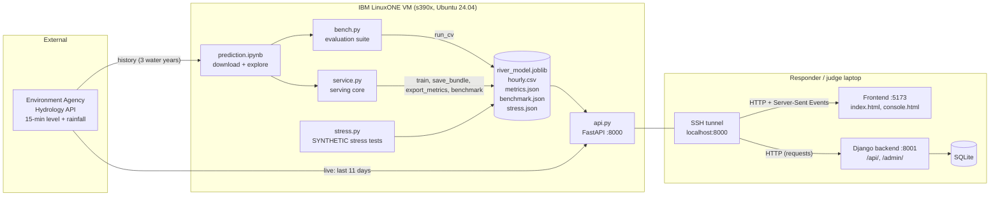

Three layers:

| Layer | Runs on | Code | Job |
|---|---|---|---|
| Model service | LinuxONE VM | `Model/` | Download data, train, evaluate, score, check data quality, serve over HTTP |
| Backend | Laptop (any machine) | `Backend/` | Store predictions, raise and acknowledge alerts, keep benchmark runs, admin UI |
| Frontend | Browser | `Frontend/` | Product page and responder console with the evidence for judges |

The pipeline is shaped `readings -> features -> score -> data-quality flags -> status`, so another hazard or gauge can
be added by swapping the readings and features without touching the rest.

---

## 2. Deployment

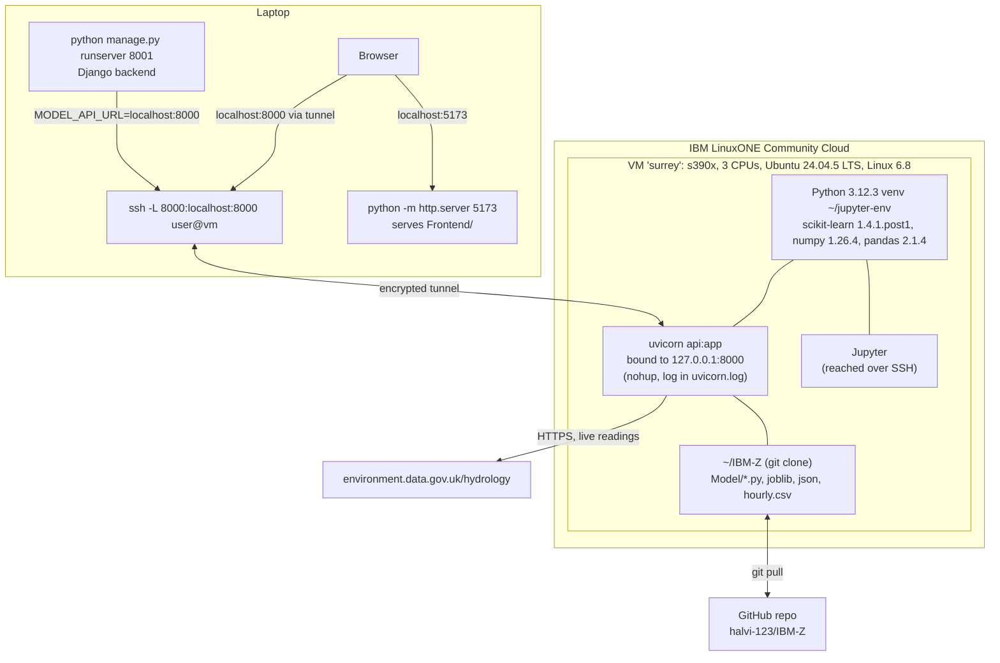

| Component | Host | Port | Started with |
|---|---|---|---|
| Model API (FastAPI + Uvicorn) | LinuxONE VM | 127.0.0.1:8000 | `cd ~/IBM-Z/Model && nohup uvicorn api:app --host 127.0.0.1 --port 8000 > uvicorn.log 2>&1 &` |
| SSH tunnel | Laptop | localhost:8000 | `ssh -L 8000:localhost:8000 <user>@<vm>` |
| Frontend (static files) | Laptop | 5173 | `python -m http.server 5173` in `Frontend/` |
| Django backend (optional) | Laptop | 8001 | `python manage.py runserver 8001` in `Backend/` |
| Jupyter | LinuxONE VM | over SSH | used for data download and training |

Everything model-related (training, the bundle, the API, the benchmark) runs on s390x. Model files saved with joblib
may not be portable across CPU architectures, so the bundle is trained and served on the same VM.

---

## 3. Data pipeline

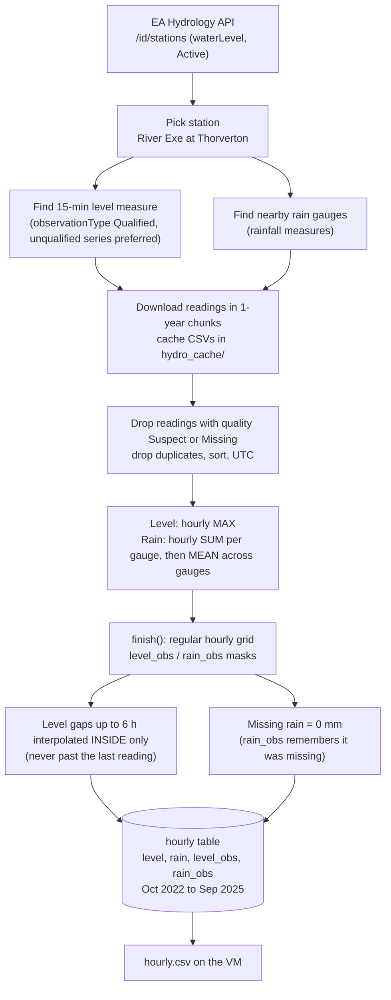

| Step | Function | Detail |
|---|---|---|
| Station search | notebook | `/id/stations?observedProperty=waterLevel&status.label=Active` by river name or lat/long |
| Measure lookup | notebook `find_measure` | `periodName=15min`, `observationType=Qualified`, plain series preferred over qualified variants |
| History download | notebook `fetch_readings` | 365-day chunks, `_limit=200000`, cached per chunk in `hydro_cache/` |
| Live download | `service.fetch_recent` | last 11 days, `_limit=20000`, 4 retries with back-off on 429/5xx, 60 s timeout |
| Quality filter | `service.fetch_measure` | readings marked `Suspect` or `Missing` dropped |
| Hourly level | `prepare_hourly` | maximum of the 15-min readings in each hour (peaks matter) |
| Hourly rain | `prepare_hourly` | sum per gauge per hour (`min_count=1`), then mean across gauges |
| Grid + masks | `service.finish` | reindex to every hour; `level_obs`, `rain_obs` record real observations |
| Gap filling | `service.finish` | level `interpolate(limit=6, limit_area="inside")`; rain NaN to 0 |

`finish` is idempotent and is applied the same way in training, replay and live scoring, so the model never sees data
prepared differently from how it was trained.

---

## 4. Features and target

All features at hour *t* use only data at or before *t* (`bench.build_features`). 17 features:

| Group | Features | Window |
|---|---|---|
| Level now | `level` | current hour |
| Level change | `level_chg_1h`, `level_chg_3h`, `level_chg_6h`, `level_chg_12h`, `level_chg_24h` | difference over 1 to 24 h |
| Recent peaks | `level_max_6h`, `level_max_24h`, `level_max_72h` | rolling maximum |
| Background | `level_mean_72h` | rolling mean |
| Rain totals | `rain_1h`, `rain_3h`, `rain_6h`, `rain_12h`, `rain_24h`, `rain_72h`, `rain_168h` | rolling sum (up to 7 days) |

The longest feature looks back 168 h; each prediction is given a 240 h window (`WINDOW_H = 168 + 72`).

**Target** (`bench.make_dataset`):

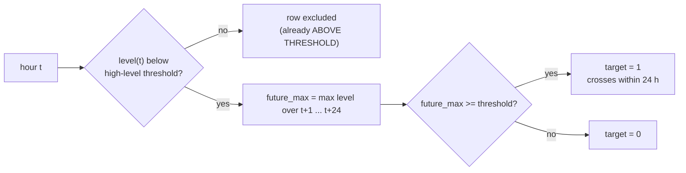

- **High-level threshold**: 95th percentile of training-period levels. For the served bundle, 1.375 m.
- **Horizon**: 24 h. Rows whose future is unknown (last 24 h of the data) are dropped.
- About 5.8% of training rows are positive on synthetic data; on real data the base rate is similar (the river is
  above its 95th percentile about 5% of the time).

---

## 5. Training and evaluation

### 5.1 Water-year split

A water year runs 1 October to 30 September, so each wet winter sits inside one year.

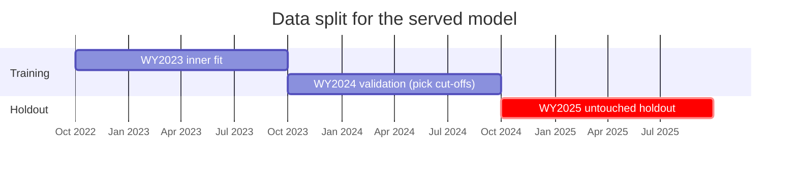

### 5.2 Cross-validation (`bench.run_cv`)

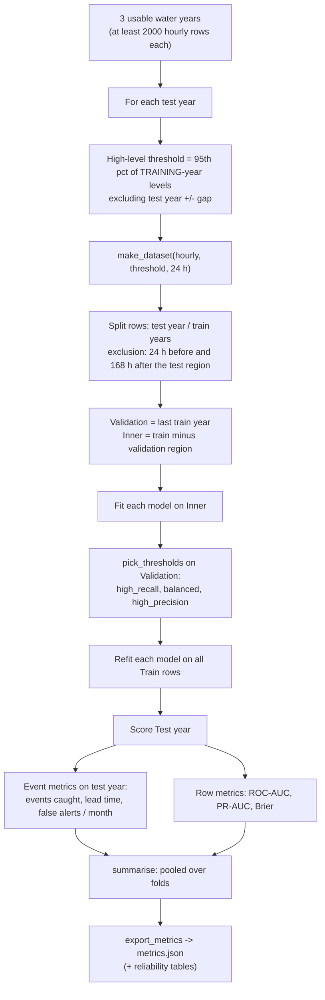

Models compared (all from scikit-learn, seed 42):

| Name | Model | Settings |
|---|---|---|
| `rule_rise_3h` | Rule (ours) | score = level change over 3 h |
| `rule_rain_24h` | Rule (ours) | score = rain over 24 h |
| `logreg` | StandardScaler + LogisticRegression | `class_weight="balanced"`, `max_iter=2000` |
| `hist_gb` | HistGradientBoostingClassifier | `max_depth=3`, `learning_rate=0.05`, `max_iter=200` |
| `rf` | RandomForestClassifier | 300 trees, `min_samples_leaf=5`, `class_weight="balanced_subsample"` |
| `rf_platt` | RF + Platt (sigmoid) calibration | Platt fitted on the validation year |

Rules are scored exactly like models: their thresholds are picked on the validation year by the same procedure.

### 5.3 Operating points (`bench.pick_thresholds`)

Candidate cut-offs are 250 quantiles of the validation scores between the 50th and 99.9th percentile.

| Operating point | Rule |
|---|---|
| `high_recall` | the HIGHEST cut-off that still reaches recall of at least 0.8 (responders care about misses) |
| `balanced` | the cut-off with the best F1 |
| `high_precision` | the LOWEST cut-off with precision of at least 0.5 |

### 5.4 Event metrics (`bench.event_metrics`)

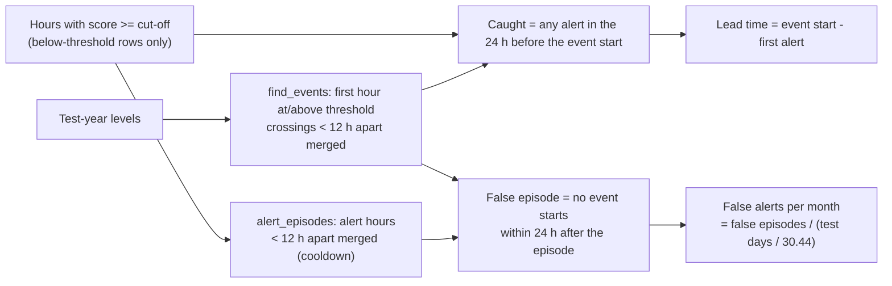

### 5.5 Results that drove the design

| Model (balanced point) | Events caught | False / month | Median lead (h) | ROC-AUC | PR-AUC | Brier |
|---|---|---|---|---|---|---|
| hist_gb | 45/45 | 2.28 | 17.0 | 0.906 | 0.352 | 0.036 |
| rf | 44/45 | 1.92 | 16.5 | 0.881 | 0.343 | 0.038 |
| rf_platt | 42/45 | 1.44 | 13.0 | 0.880 | 0.318 | 0.036 |
| logreg | 44/45 | 2.44 | 23.5 | 0.884 | 0.339 | 0.117 |
| rule_rain_24h | 33/45 | 2.67 | 14.0 | 0.799 | 0.143 | n/a |
| rule_rise_3h | 45/45 | 3.67 | 7.0 | 0.513 | 0.155 | n/a |

45 events across 3 water years (11, 25, 9), one gauge. Calibration, top bin: hist_gb 0.30 predicted vs 0.30 observed;
rf 0.44 vs 0.30. Hence the served model is HistGradientBoosting with no calibration step.

### 5.6 Training the served bundle (`service.train`)

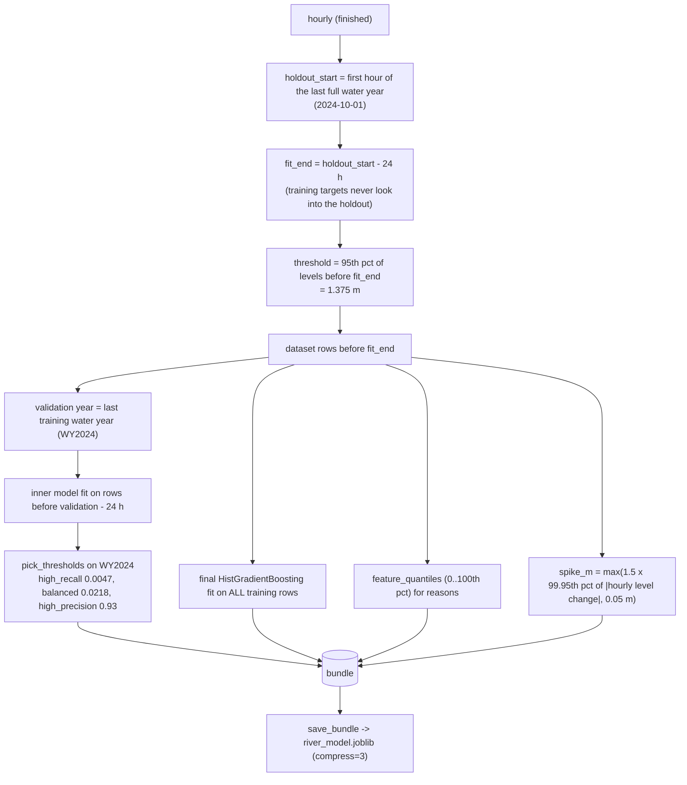

The bundle stores: model, feature list, threshold (and its percentile), horizon, operating points, validation year,
training range, holdout start, row counts, positive rate, feature quantiles, spike size, scikit-learn version, CPU
architecture it was trained on, and station metadata (name, EA level measure, rain measures). `load_bundle` warns if
the scikit-learn version differs.

---

## 6. Serving path

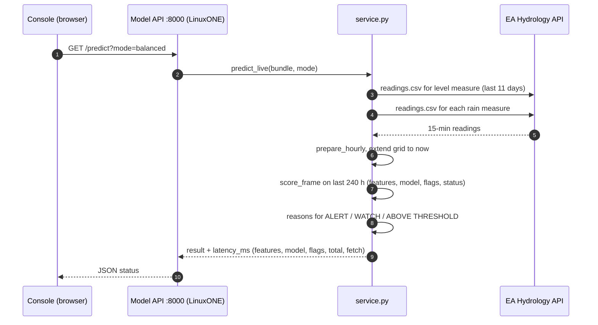

`score_frame` is the single scoring path for live prediction, replay and the benchmark. Replaying a period
vectorised and replaying it hour by hour give identical probabilities (checked).

Prediction result (one hour):

| Field | Meaning |
|---|---|
| `status` | one of the six statuses (section 7) |
| `probability` | chance of crossing the high level within 24 h |
| `level_m`, `level_threshold_m` | current level and the high level |
| `alert_threshold`, `watch_threshold`, `mode` | cut-offs in use |
| `data_age_h` | hours since the last real level reading |
| `flags` | `stale`, `stuck_sensor`, `sudden_spike`, `rain_offline`, `missing_level_hours_24h` |
| `reasons` | up to 3 inputs above the 80th percentile of training hours |
| `latency_ms` | `features`, `model`, `flags`, `total` (+ `fetch` for live) |
| `disclaimer` | "Decision support, not an official warning..." |

Modes (`service.mode_thresholds`):

| Mode | ALERT at probability >= | WATCH at probability >= |
|---|---|---|
| balanced (default) | the higher of high_recall / balanced (0.0218) | max(lower point, alert / 2) (0.0109) |
| sensitive | the lower point (0.0047) | half of that |

---

## 7. Data-quality checks and status logic

### 7.1 Checks (computed every hour in `score_frame`)

| Check | Exact rule | Effect |
|---|---|---|
| Stale | more than 3 h since the last observed level (`STALE_H = 3`); never observed = stale | DATA STALE |
| Missing hours | more than 6 unobserved level hours in the last 24 (`MAX_GAP_H = 6`) | DATA ISSUE |
| Stuck sensor | observed level range < 0.5 mm over a 24 h rolling window (`STUCK_H = 24`, min 12 readings) | DATA ISSUE |
| Rain offline | no rain observation for 24 consecutive hours | DATA ISSUE |
| Sudden spike | one-hour jump in observed level > `spike_m` from the bundle | flag only |

### 7.2 Status decision

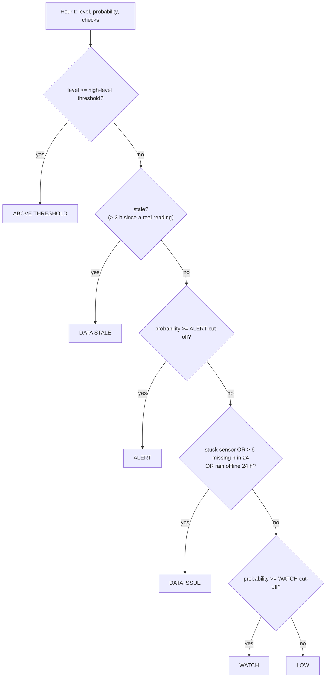

Why this order:

- **ABOVE THRESHOLD first**: if the river is already high, that is the fact that matters.
- **DATA STALE above ALERT**: an ALERT computed from data several hours old could be out of date.
- **ALERT above DATA ISSUE**: if the model sees danger even through imperfect data, the responder should still see
  the alert; the data warning stays visible as a flag.
- **DATA ISSUE above WATCH and LOW**: bad data never produces a confident LOW.

### 7.3 Reasons

`service.reasons` compares six inputs (level, 3 h and 12 h rise, rain over 6, 24 and 72 h) with the stored percentiles
of training hours and returns up to three that are at or above the 80th percentile, for example
"Rain in last 24 h: 31.2 mm (higher than 97% of training hours)". They describe the situation and are not model
attributions.

---

## 8. Model API

`Model/api.py`, FastAPI, loaded once at start-up (`lifespan`): the bundle (`MODEL_PATH`) and `hourly.csv`
(`HOURLY_CSV`). CORS is open because the API is only reachable through the SSH tunnel.

| Method | Path | Parameters | Returns |
|---|---|---|---|
| GET | `/health` | | model, threshold, horizon, operating points, training and holdout ranges, replay range, suggested replay range, wildcards, machine info, disclaimer |
| GET | `/predict` | `mode` | live prediction from EA data (502 if EA is unreachable) |
| POST | `/predict` | `{"readings":[{"time","level","rain"}], "mode", "now"}` | prediction from posted readings |
| GET | `/replay` | `start`, `end`, `mode` | hourly rows (level, prob, status, flags, `crosses_within_h`), events, warnings; max 120 days |
| GET | `/replay/stream` | `start`, `end`, `mode`, `speed` (0 to 1000 h/s), `scenario` | Server-Sent Events, one prediction per hour, then `event: done` |
| GET | `/metrics` | | `metrics.json` + `last_benchmark` (benchmark.json) + `stress_tests` (stress.json) |
| GET | `/benchmark` | `n` (10 to 5000), `mode` | runs the benchmark on this machine and saves benchmark.json |

Environment variables: `MODEL_PATH`, `HOURLY_CSV`, `METRICS_JSON`, `BENCH_JSON`, `STRESS_JSON`.

---

## 9. Replay and live-style streaming

Two replay paths share the same scoring:

| Path | Function | How | Used by |
|---|---|---|---|
| Vectorised | `service.replay` | one `score_frame` over the period plus 240 h of history; truth from `future_max` | `/replay`, backend replay proxy, Break the sensor |
| Hour by hour | `service.replay_steps` | for each hour, `predict_window` on exactly the 240 h ending at that hour | `/replay/stream` |

`replay` warns when the period overlaps training data; the demo replays the holdout year only.

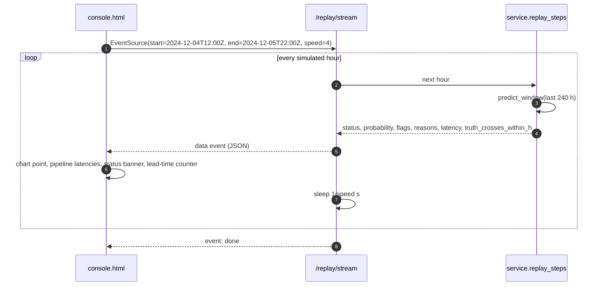

On the December 2024 holdout event the stream goes LOW, then ALERT at 4 Dec 17:00, then ABOVE THRESHOLD at
5 Dec 20:00: the first ALERT came 27 h before the crossing.

---

## 10. Stress tests and wildcards (SYNTHETIC)

Real holdout events, deliberately damaged inputs. Never used as training data; always reported separately.

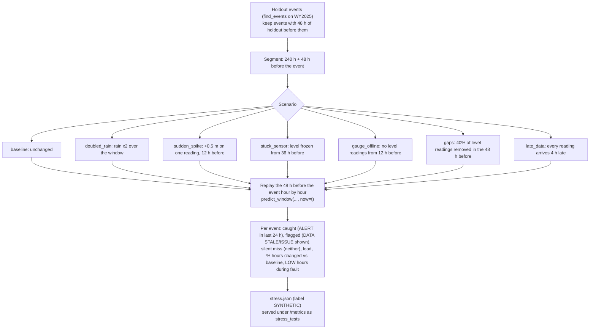

Truth (event times) always comes from the undamaged data. Balanced-mode results on 9 holdout events: one silent miss
in total (stuck sensor); gauge offline and late data flagged on 9/9 events; gaps 9/9 caught.

**Wildcards** reuse the same damage functions on the live-style stream: `/replay/stream?...&scenario=gauge_offline`.
The model sees the damaged data; each message carries `synthetic: true`, the scenario name and description, and
`true_level_m` from the undamaged data so the console can draw what the sensor hid.

---

## 11. Benchmark on LinuxONE

`service.benchmark` (also `GET /benchmark`):

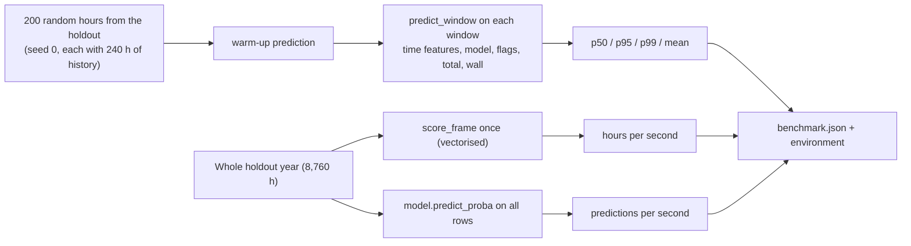

Measured on the VM (s390x, 3 CPUs, Python 3.12.3, scikit-learn 1.4.1.post1):

| Step | p50 (ms) | p95 (ms) | p99 (ms) |
|---|---|---|---|
| Features | 3.19 | 3.40 | 3.46 |
| Model | 2.80 | 3.11 | 4.32 |
| Data checks | 1.88 | 2.11 | 2.32 |
| Total, data in memory to status | 7.92 | 8.40 | 9.41 |
| Wall clock | 8.82 | 9.36 | 10.33 |

Full-year replay: 8,760 h in 0.038 s (about 232,000 hours/s). Model alone: about 306,000 predictions/s. Network fetch
from the EA API is excluded and reported separately by live predictions. Numbers are reported as measured.

---

## 12. Django backend

Django 6.1 project `config`, app `alerts`, plain views (no Django REST Framework). It never imports model code; it
calls the model API over HTTP (`MODEL_API_URL`, default `http://localhost:8000`, timeout `MODEL_API_TIMEOUT` = 30 s;
replay 120 s, benchmark 300 s).

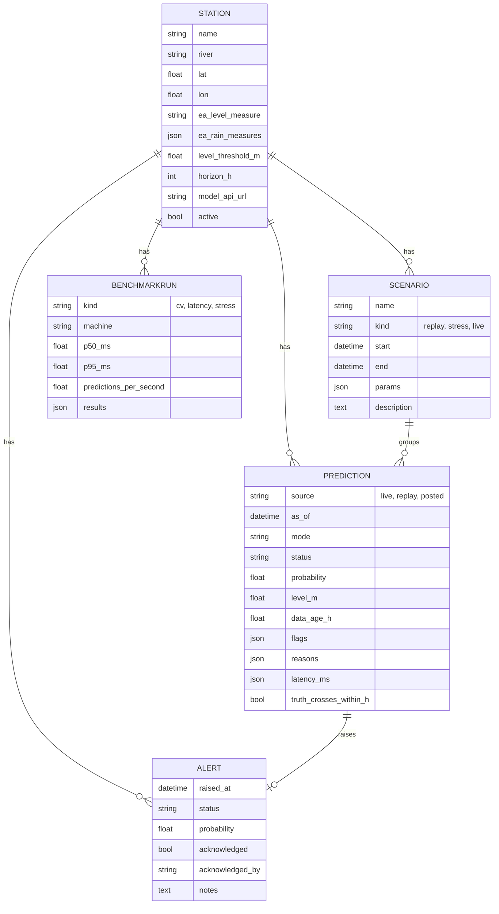

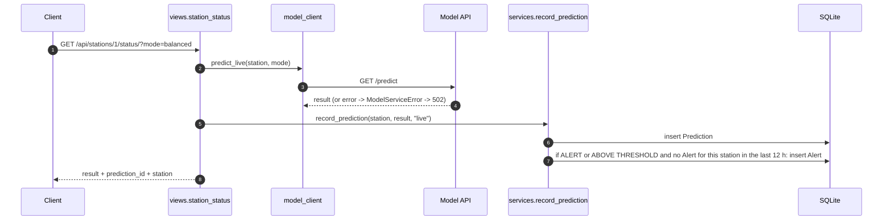

| Method | Path | Does |
|---|---|---|
| GET | `/api/health/` | backend status + model API health (503 if unreachable) |
| GET | `/api/stations/` | active stations |
| GET | `/api/stations/<id>/status/` | live prediction, stored, may raise an Alert |
| GET | `/api/stations/<id>/replay/` | proxy to `/replay` + a `stream_url` for EventSource |
| GET | `/api/predictions/` | stored predictions (filter by station, source, limit) |
| GET | `/api/alerts/` | alert feed |
| POST | `/api/alerts/<id>/ack/` | acknowledge, body `{"by": "name"}` |
| GET | `/api/metrics/` | pass-through of the model API `/metrics` |
| GET, POST | `/api/benchmarks/` | stored runs / run the VM benchmark and store it |

`manage.py seed_station` creates the Thorverton station and copies the threshold and horizon from `/health`. The
Django admin (`/admin/`) doubles as a performance UI: predictions filterable by status, source, mode; alerts by
acknowledgement; benchmark runs by machine; stress scenarios shown as SYNTHETIC.

---

## 13. Frontend

Plain HTML, CSS and JavaScript, Chart.js 4.4.1 from jsDelivr, no build step. Both pages call the model API at
`http://localhost:8000` directly (through the tunnel).

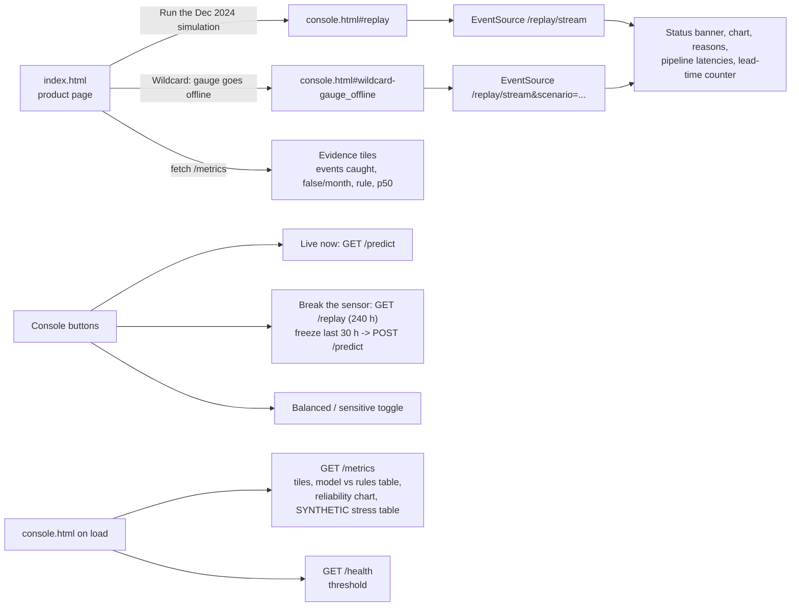

Console layout, top to bottom: top bar (station, high level, feed state, mode, machine, API state); disclaimer strip;
status banner (status colour block, plain-language headline, chance of crossing with cut-offs, level gauge against
the high level, alert lead time, data age, data checks); controls; level and probability chart (plus the grey true
level during wildcards); why this status; per-step pipeline latency; performance evidence; model vs rules table;
reliability curve; SYNTHETIC stress table.

---

## 14. Artifacts and files

| File | Produced by | Where | In git |
|---|---|---|---|
| `hydro_cache/*.csv` | notebook | VM | no (regenerable) |
| `hourly.csv` | notebook `hourly.to_csv` | VM `Model/` | no (regenerable) |
| `river_model.joblib` | `service.save_bundle` | VM `Model/` | yes |
| `metrics.json` | `service.export_metrics` | VM `Model/` | yes |
| `benchmark.json` | `service.benchmark` / `GET /benchmark` | VM `Model/` | yes |
| `stress.json` | `python stress.py` | VM `Model/` | copy back to commit |
| `uvicorn.log` | uvicorn | VM `Model/` | no |
| `db.sqlite3` | Django migrate | laptop `Backend/` | no |

---

## 15. Security and operations

- The model API binds to `127.0.0.1` on the VM; the only way in is the SSH tunnel. No port is open to the internet.
- Never committed (`.gitignore`): `.env` files, SSH keys (`*.pem`, `*.key`, `id_rsa*`, `id_ed25519*`), token files,
  data caches, `hourly.csv`, `jupyter-env/`, SQLite database.
- Django reads `DJANGO_SECRET_KEY` and `DJANGO_DEBUG` from the environment (development defaults for the demo).
- EA API calls send a clear `User-Agent`, retry with back-off on 429 and 5xx, and time out after 60 s.
- Model API failures are surfaced, not hidden: `/predict` returns 502 with the reason; the backend returns 502/503 with
  `ModelServiceError`; the frontend shows "model API offline" and the live data figures stay blank.
- Operational check on the VM: `pgrep -af "uvicorn api:app"` should show exactly one process.

---

## 16. Design decisions

| Decision | Why |
|---|---|
| Predict "crossing the gauge's high level", not "flood" | Measurable and checkable; flooding depends on local defences |
| Leave-one-water-year-out evaluation | Keeps whole wet seasons together and tests on unseen years |
| Thresholds picked inside training years only | No peeking at test data; the holdout is reported once |
| Events and false alerts per month, not accuracy | The river is above its high level about 5% of the time, so accuracy is misleading |
| Compare with rules we built | Honest baseline; no outside accuracy figures quoted |
| HistGradientBoosting, no calibration | As good as the alternatives, and its probabilities are already honest (0.30 vs 0.30) |
| One scoring function for live, replay and benchmark | What we measure is exactly what we serve |
| Data checks before trusting the model | A broken sensor must never become a confident LOW |
| ALERT outranks DATA ISSUE | A real danger signal should not be hidden by imperfect data |
| Train and serve on the same s390x VM | joblib portability across architectures is not guaranteed |
| Synthetic tests labelled and kept separate | They show behaviour under faults, not real-world performance |
| Backend calls the model over HTTP | Clean boundary; the model service can move or scale independently |

---

## 17. Extending the system

- **Another gauge**: create a `Station` (backend), point the notebook at its EA measures, train a bundle on the VM,
  and set `model_api_url` per station if it is served separately.
- **Another hazard**: replace the readings and `build_features`; `score_frame`, the data checks, statuses, API,
  stress tests and console stay the same.
- **Faster stuck-sensor detection**: shorten `STUCK_H` or compare against upstream gauges; re-run `stress.py` to
  measure the effect on silent misses.
- **Production hardening**: run uvicorn under systemd, put the API behind an authenticated reverse proxy, and serve
  the frontend from the same origin.
