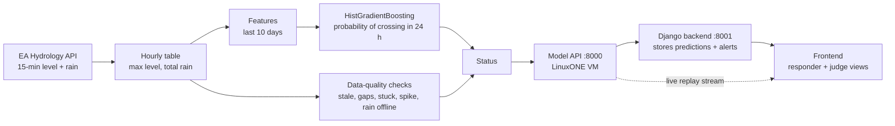

# How it works

This explains the whole system from the river gauge to the status a responder sees. No machine learning
background is assumed.

> Decision support, not an official warning.

## The question we answer

> "The river is below its high level right now. Will it cross that level at any point in the next 24 hours?"

- **High level**: the 95th percentile of river levels in the training data. The river is above it about 5% of
  the time. For the served model this is 1.375 m at Thorverton.
- **Next 24 hours**: the horizon. We only ask the question while the river is still below the line. Once it is
  above, the status is simply ABOVE THRESHOLD.

## Flowchart

## Step 1: data

Source: the Environment Agency Hydrology API (Open Government Licence).

- **River level** at Thorverton, every 15 minutes. We keep the highest reading in each hour.
- **Rainfall** from nearby rain gauges, every 15 minutes. We add up each hour and average across gauges.
- **Period**: three water years, October 2022 to September 2025. A water year runs October to September, so
  one whole wet winter sits inside one year instead of being split.
- **Gap handling**: short gaps in the level (up to 6 hours) are filled by drawing a straight line between the
  readings on either side. We never fill past the latest reading, because in real time we do not know the
  future. Missing rain counts as zero, but we remember it was missing so the flags can see it.

## Step 2: features

A feature is a number describing the recent past. Each hour gets these, all built only from data up to that
hour (`bench.build_features`):

| Group | Features | Plain meaning |
|---|---|---|
| Level now | `level` | How high the river is |
| Level change | change over 1, 3, 6, 12, 24 h | Is it rising, and how fast |
| Recent peaks | highest level in last 6, 24, 72 h | Has it been high recently |
| Background | average level over 72 h | Is the catchment already wet |
| Rain totals | rain over 1, 3, 6, 12, 24, 72, 168 h | How much water is on its way |

The longest feature looks back 168 hours (7 days); the service keeps 240 hours (10 days) of history per
prediction to be safe.

## Step 3: the model

**HistGradientBoostingClassifier** from scikit-learn, with small trees (depth 3), 200 rounds, learning rate 0.05.
It is a set of many small decision trees, each one correcting the mistakes of the ones before. It outputs a
probability between 0 and 1.

Why this one:

- It beat our rules clearly (PR-AUC about 0.35 against about 0.14 across 45 events).
- It was as good as random forest and logistic regression (they are within noise of each other).
- Its probabilities are honest without extra calibration: in the top bin it predicted 0.30 and the observed
  rate was 0.30. Random forest said 0.44 for the same observed 0.30.

## Step 4: turning a probability into a decision

A probability alone does not tell a responder what to do, so we pick cut-offs called **operating points**. They
are chosen on a validation year inside the training data, never on the test data:

| Operating point | Rule used to pick it |
|---|---|
| high recall | the highest cut-off that still catches at least 80% of crossing hours |
| balanced | the cut-off with the best F1 (balance of catching crossings and avoiding false alarms) |
| high precision | the lowest cut-off where at least half of alerts are right |

The service has two **modes** that use these:

| Mode | ALERT when probability is at least | WATCH when probability is at least |
|---|---|---|
| balanced | the balanced point | the high-recall point (or half the balanced point, whichever is higher) |
| sensitive | the high-recall point | half of that |

## Step 5: data-quality checks

A model fed broken data can say LOW with confidence. That is the most dangerous output for a responder, so the
service checks the data first (`service.score_frame`):

| Check | Rule | Leads to |
|---|---|---|
| Stale | more than 3 hours since the last real level reading | DATA STALE |
| Missing hours | more than 6 of the last 24 hours have no level reading | DATA ISSUE |
| Stuck sensor | level flat to within 0.5 mm for 24 hours | DATA ISSUE |
| Rain offline | no rain readings at all for 24 hours | DATA ISSUE |
| Sudden spike | one-hour jump bigger than anything normal in training (at least 5 cm) | flag only |

## Step 6: the status

Every hour gets exactly one status. When several apply, the one higher in this list wins:

| Priority | Status | Meaning for a responder |
|---|---|---|
| 1 | ABOVE THRESHOLD | The river is already above the high level |
| 2 | DATA STALE | We have not heard from the gauge recently; do not trust anything below this line |
| 3 | ALERT | Good chance of crossing the high level within 24 h |
| 4 | DATA ISSUE | Data looks unreliable; any LOW or WATCH is not to be trusted |
| 5 | WATCH | Elevated chance, keep an eye on it |
| 6 | LOW | Low chance, data looks fine |

ALERT sits above DATA ISSUE on purpose: if the model sees danger even through imperfect data, the responder
should still see the alert. DATA STALE sits above ALERT because a stale ALERT could be hours out of date.

Each prediction also comes with **reasons**: inputs that are unusually high compared with training hours, for
example "Rain in last 24 h: 31.2 mm (higher than 97% of training hours)". These describe the situation. They
are not an explanation of how the model reached its number, and we say so in the UI.

## Step 7: how we measured accuracy

### Cross-validation by water year

We have three water years. We train on two and test on the third, three times, so every year is tested once
(`bench.run_cv`). Inside each round, the high-level threshold and the operating points are chosen from the
training years only. In total the test years contain **45 events** (11, 25 and 9).

### Events, not hours

An **event** starts at the first hour the river crosses the high level. Crossings less than 12 hours apart
count as one event. We report:

- **Events caught**: an ALERT at some point in the 24 hours before the event started.
- **Lead time**: how long before the event the first ALERT came. Capped at 24 h by the horizon.
- **False alerts per month**: runs of ALERT hours (gaps under 12 h merged) that were not followed by an event.

### Holdout year

The served model is trained on WY2023 and WY2024 only. WY2025 (from 2024-10-01) is never seen during training
or threshold picking. Replays in the demo use this year, and the service warns if you replay a period it was
trained on.

## Step 8: stress tests (SYNTHETIC)

`Model/stress.py` asks "what happens when the data goes wrong just before a real event?". For each real
holdout event it damages the input in one way and replays the 48 hours before the event hour by hour, using
the same prediction function as the live service. Whether an event really happened is always judged on the
undamaged data.

| Scenario | What we do to the data |
|---|---|
| baseline | nothing (reference) |
| doubled_rain | rain doubled across the whole input window |
| sudden_spike | one level reading 12 h before the event raised by 0.5 m |
| stuck_sensor | level frozen from 36 h before the event |
| gauge_offline | no level readings from 12 h before the event |
| gaps | 40% of level readings removed in the 48 h before the event |
| late_data | every reading arrives 4 h late |

The most important column is **silent misses**: events where the responder saw neither an ALERT nor a data
warning. A good system can miss an event because of bad data, but it should say the data is bad.

Stress tests are never training data and are always reported separately, labelled SYNTHETIC.

## Step 9: speed on LinuxONE

`service.benchmark` times 200 single predictions on holdout data (features, model, flags) and a full-year
vectorised replay on the VM. Median end-to-end time is about 8 ms per prediction on s390x, and a whole year
of hourly history scores in about 0.04 s. See [progress.md](progress.md) for the full table.

## Known limits

- One gauge, three years, 45 events. Differences between models are within noise.
- The horizon caps lead time at 24 h.
- Reasons are descriptive, not model attributions.
- A stuck sensor takes 24 hours to detect, and a spike only raises a flag.
- The balanced alert cut-off is low, so ALERT is on for about 11% of holdout hours. Those hours form about 3
  alert episodes a month, of which 2.25 were false (9 holdout events, see [progress.md](progress.md)).
- Model files saved with joblib may not load on a different CPU architecture; we train and serve on the VM.
